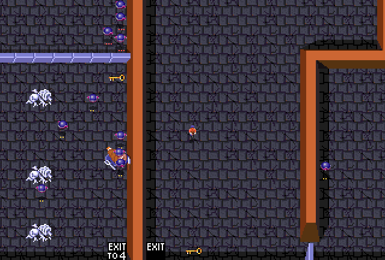

# Gauntlet: The Smash T.V. Edition

**Play it at [smash-gauntlet.atomic14.com](https://smash-gauntlet.atomic14.com)**: on a
desktop, with a gamepad, or on your phone.



A mash-up of two arcade games in the browser. The mazes, walls, floors, doors, generators,
food, treasure, keys and potions are **Gauntlet**'s (Atari Games, 1985). The contestant,
the monsters, the sound effects, the music and the host's voice are **Smash T.V.**'s
(Williams, 1990). Like the [Smash T.V. browser port](https://smashtv.atomic14.com) it is built on, it isn't an
emulator. The game is written fresh in TypeScript, and the art, sound and level data come
from the original ROMs.

## The casting

| Gauntlet | Played by (Smash T.V.) | What it does |
|---|---|---|
| Hero | the contestant | twin-stick movement and fire; health ticks away a point a second |
| Ghost | floating orb | flies at you and bursts, 10/20/30 damage |
| Grunt | grunt | walks up and clubs you |
| Demon | spear thrower | bites, and fires along the eight directions when lined up |
| Lobber | Mr. Shrapnel | keeps its distance and lobs shrapnel over walls |
| Sorcerer | the flickering orb | fades in and out; can't be hit while faded |
| Death | Mutoid Man's head | drains up to 200 health and leaves; shots glance off it, only a potion kills it (1000) |
| Special potions | power-ups | shield, rockets, spread gun, blades, speed (2 per maze, 3 from level 5, 4 from level 10) |

Monsters come in Gauntlet's three strengths (shown by pips): each hit knocks one down a
level, and generators drop a level per hit too.

The narrator's lines go to the Smash T.V. host. You hear "Contestant one!", then "Good
luck!" and "You'll need it!" at the start. Treasure gets "Big money!", food "I'd buy that
for a dollar!", a key "Bingo!" and a potion "Big prizes!". Using a potion gets "Total
carnage! I love it!". Shooting the food gets "No way!", low health gets "Ten seconds!",
Death laughs as it drains you, and the crowd applauds you out of each exit.

## Controls

| | Move | Fire | Potion | Start / pause |
|---|---|---|---|---|
| Keyboard | WASD | Arrow keys (or IJKL) | Space, E or Shift | Enter / P or Esc (M mutes) |
| Gamepad | Left stick / d-pad | Right stick, or face buttons | Shoulder buttons / triggers | Start |
| Touch | Left thumbstick | Right thumbstick | BOMB button | Tap |

The picture starts on a CRT display (from the golden-axe port: glowing scanlines that swell on
bright colours, an aperture grille and curved glass, drawn by a WebGL shader in
`src/filter.ts`). **F**, or the CRT button on touch screens, switches it off and on, and the
choice is remembered.

Keys open doors (a whole door at a time), potions clear the screen, and exits take you to
the next maze ("EXIT TO 4" and "EXIT TO 8" on level 1 skip ahead, as in the arcade).
Destructible walls crumble after three shots, traps remove the trap walls, and
transporters send you to the nearest other transporter. Some transporters are walled in
(levels 8, 33 and 81): let go of the stick and push again to travel on. At 0 health you get Smash T.V.'s
continue screen, where Start buys another 700 health.

## Credits

**Gauntlet** was designed by **Ed Logg** and released by **Atari Games** in 1985.
**Smash T.V.** was created by **Eugene Jarvis** and **Mark Turmell** and released by
**Williams Electronics Games** in 1990. Everything that makes either game what it is
belongs to them and to the current rights holders (Warner Bros. for both catalogues). This
is a non-commercial fan project, not affiliated with or endorsed by any of them.

It leans on [MAME](https://www.mamedev.org/), whose `gauntlet` driver documents the
hardware and whose Lua scripting made it possible to check our decoding against the real
game, on [Capstone](https://www.capstone-engine.org/) for disassembling the 68010 code, on
the old [Gauntlet hackers' pages](https://irobot.xmission.com/Web%20Archives/ionpool.net%20(Dec-31-2020)/arcade/gauntlet/)
(ionpool.net, archived) for the memory map, and on
[Whisper](https://github.com/openai/whisper) for working out which speech clip is which.

## How the Gauntlet side was recovered

Nothing here is redrawn or retyped. It all comes from the ROM set:

1. **Mazes.** Under MAME, a read tap on the maze ROM area showed the routine that decodes
   a level (`0x4ad06`). It's compiled C, so the 68010 disassembly ported cleanly
   (`tools/gauntlet-rom.ts`). The maze ROMs sit behind Atari's slapstic, so each maze's
   bank was found by decoding every maze in every bank and keeping the one that decodes
   cleanly and ends where the next maze in that bank begins. Level 1 then matched MAME's
   live maze cell for cell.
2. **Walls and floors.** The playfield builder (`0x4273a` floors, `0x42b92` walls,
   `0x41bda` exits) picks each cell's 2x2 tiles from neighbour masks and tables in ROM.
   `src/game/playfield.ts` is a port of it, and it produces exactly the tile words that
   MAME's playfield RAM holds for level 1 (all 1024 cells; `tools/explore/check-pf.ts`).
   The game redraws a cell and its neighbours whenever one changes, as the original does
   (`0x42898`).
3. **Palettes.** Each level's floor and wall colours come from header byte 9 and the
   tables the loader at `0x413aa` copies into colour RAM.
4. **Objects.** Generators, food, potions, treasure and keys are motion objects: one per
   maze cell, with the picture, size and colour of each cell code in tables at `0xc534`,
   `0xc624` and `0xc660`. Doors are built from pieces picked by neighbour (`0x43e12`) and
   by the walls at each end of a run (`0x43f0c`, `0x44080`).

The Smash T.V. side (sprites, animations, fonts and the recorded sound board) is copied from
the smashtv port's `public/assets`.

## Building it yourself

The extracted data is checked in under `public/assets/`, so playing and building only need
Node:

```sh
npm install
npm run dev      # http://localhost:5240 (also on your LAN)
npm run build    # static site in dist/
```

To regenerate the Gauntlet data from the ROM set (`gauntlet.zip`, as used by MAME):

```sh
npm run extract -- /path/to/gauntlet.zip
```

MAME itself wants a 16K alphanumerics ROM (`136037-104.6p`, the second half all zeros).
Some sets carry the 8K dump, which the extractor is happy with but MAME rejects. Pad it with
8K of zeros if you want to run the original alongside.

`tools/play.ts` drives the game in headless Chrome (`npx tsx tools/play.ts tests/gameplay.js
http://localhost:5240/`): the tests check keys, doors, combat, potions, exits, the continue
screen and performance, and `tests/demo-gif.js` with `tools/gif.sh` makes the GIF above.

## Technical notes

The hardware is Atari's Gauntlet board: a 68010, a 6502 for sound, and one set of 8x8 tiles
shared by the scrolling playfield and the motion objects.

- **Program ROM**: `1307/1308` hold `0x00000-0x0ffff` (each chip's second half first),
  `1409/1410` hold `0x40000-0x4ffff`, and `205/206` (the mazes) sit behind the slapstic at
  `0x38000`: four 8K banks through one window.
- **Tiles**: chips `111-118`, four bit planes of `0x10000` bytes, stored inverted; the last
  plane is the most significant bit. Playfield words are tile `0-11` (xor `0x800`), colour
  `12-14`, flip `15`; the playfield is column-major, 64x64.
- **Palette**: `IIII RRRR GGGG BBBB`. The playfield uses colours `0x18-0x1f`: floor
  (`0xf1c0[fc]`), walls (`0xf3e0[wc]`), exits (`0xf660`), trap floor, then wall colours
  dimmed by `0x3000`/`0x5000` intensity for damaged walls. Shadows (pen 1 of a motion
  object) select the copy dimmed by `0x7000`.
- **Maze table**: 114 pointers at `0x38032`. Each maze is a 14-byte header (byte 8: floor
  and wall pattern, byte 9: floor and wall colour, bytes 10-13: four shorthand codes)
  then a stream. `00cccccc` is one cell, `01ttnnnn` uses a header shorthand (a vertical
  run, floor before or after, or a wall run), `100nnnnn` repeats the last code, `101vnnnn`
  is a wall run (`v`: vertical, drawn upwards), and `11wnnnnn` is floor then an optional
  wall. Row 0 is the top wall, which is also the bottom.
- **Cell codes**: `01` wall, `03/04` doors, `05` start, `06/07/08` exit, exit to 4, exit
  to 8, `09-17` ghosts, grunts, demons, lobbers and sorcerers at three strengths, `18`
  Death, `19-27` their generators, `28` treasure, `2a` cider, `2b` food (random picture
  from `0xcbe2`), `2c/2d` potions, `2e` amulet, `35` key, `38` destructible wall (`37`,
  `36` as it's damaged), `39` trap wall, `3a` trap, `3b` transporter.
- **Live maze** (MAME): the cell code is the top 6 bits of each motion object's link word
  (`0x903800`), and walls are motion objects with picture `0x8000`.

### Tools

- `tools/extract.ts`, `tools/gauntlet-rom.ts`: build `public/assets/gauntlet/` from the ROM zip.
- `tools/mame/*.lua`: MAME probes (start a game and dump RAM, screen grabs, read/write taps
  by PC, the maze decoder's ROM reads).
- `tools/explore/`: the disassembler wrapper (`dis.py`), maze and object contact sheets,
  the playfield check against MAME, and a level renderer.
